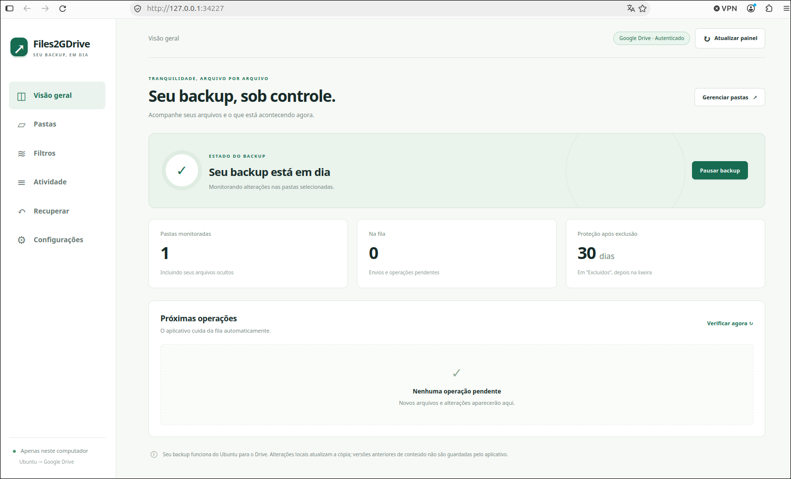

# Files2GDrive

Backup contínuo de arquivos locais do Ubuntu para o Google Drive, com configuração pelo navegador e controles na bandeja do sistema.



**Versão alpha para Ubuntu 24.04 LTS, amd64 e Python 3.12.** O projeto está em desenvolvimento e deve ser avaliado com dados de teste antes de ser usado como única cópia de arquivos importantes.

## Funcionalidades

- Monitora alterações locais e mantém os arquivos correspondentes no Drive atualizados.
- Seleciona pastas por checkboxes, com navegação pela pasta pessoal, diretórios ocultos e exceções por subpasta. As alterações são revisadas antes de aplicar.
- Exclui arquivos do envio por padrões globais ou por pasta, incluindo extensões e coringas `*` e `?`.
- Mantém arquivos removidos localmente em **Excluídos por 30 dias**; depois, envia-os à lixeira do Drive. Não faz exclusão definitiva.
- Usa fila persistente, novas tentativas com espera progressiva, até quatro uploads simultâneos e preparação de diretórios em lotes.
- Exibe autenticação e progresso, permite pausar e retomar e oferece logs locais de operações.
- Abre a configuração pelo menu da bandeja, com opções para pausar, retomar e sair.
- Inclui consulta e restauração de backups e reconexão com conferência dos dados existentes.

A sincronização é **Ubuntu → Google Drive**. Alterações no Drive não são copiadas de volta ao computador. Edições locais substituem o conteúdo da cópia corrente; o aplicativo não mantém histórico próprio de versões.

## Instalar

Baixe o pacote `.deb` na [release v0.1.0-alpha3](https://github.com/eduardoellery/Files2GDrive/releases/tag/v0.1.0-alpha3) e execute no diretório do arquivo:

```bash
sudo apt install ./files2gdrive_0.1.0-alpha3_amd64.deb
```

O APT instala as dependências nativas; as dependências Python já estão incluídas no pacote. Não é necessário instalar `pip` ou `watchdog` separadamente.

Abra **Files2GDrive** no menu de aplicativos. Na configuração inicial:

1. Clique em **Conectar ao Google** e autorize sua própria conta.
2. Escolha os nomes da pasta principal e do computador no Drive.
3. Marque as pastas locais, revise os efeitos e aplique a seleção.

O destino segue a organização:

```text
Pasta principal / Nome do computador / Pastas selecionadas
```

A pasta principal padrão é `Files2GDrive`. O nome inicial do computador vem do hostname e pode ser escolhido pelo usuário antes do primeiro backup. Alterar esses nomes depois de iniciar os envios ainda não está disponível na interface.

Para atualizar o pacote, saia pelo menu da bandeja antes de instalar a nova versão. Veja [instalação, atualização e remoção](docs/INSTALACAO-DEB.md) e [integração com a sessão Ubuntu](docs/INTEGRACAO-DESKTOP.md).

### Conta Google e OAuth

Cada instalação usa uma conta, autenticada pelo próprio usuário no navegador. O pacote do distribuidor pode incluir a identificação OAuth Desktop do aplicativo; ele não inclui autorização, senha ou tokens de usuários. Os tokens são guardados no cofre Secret Service da sessão Ubuntu.

Se o projeto OAuth do distribuidor estiver em **Testing**, somente contas autorizadas como testadoras conseguem entrar. Publicar o código não remove essa restrição. Contas Google Workspace também podem depender das políticas e da aprovação do administrador da organização. Quando a autorização precisar ser renovada, a fila permanece salva até a reconexão.

Quem desenvolver ou redistribuir o aplicativo precisa configurar seu cliente OAuth Desktop e habilitar a Drive API. Consulte o [guia de integração com o Google Drive](docs/GUIA-GOOGLE-DRIVE.md). Não publique tokens, perfis de execução ou arquivos de credenciais pessoais.

## Executar pelo código-fonte

Use Python 3.12 no Ubuntu 24.04. Para a bandeja e o cofre da sessão:

```bash
sudo apt install python3-venv python3-gi gir1.2-gtk-3.0 \
  gir1.2-ayatanaappindicator3-0.1 libnotify-bin xdg-utils gnome-keyring
git clone https://github.com/eduardoellery/Files2GDrive.git
cd Files2GDrive
python3 -m venv --system-site-packages .venv
. .venv/bin/activate
python -m pip install -e .
python -m files2gdrive --help
```

O acesso aos pacotes do sistema no ambiente virtual permite usar os bindings GTK instalados pelo APT. No GNOME, a bandeja também depende da extensão AppIndicator habilitada na sessão; veja o guia de integração Ubuntu.

### Teste local sem Google

Um perfil novo iniciado pelo código-fonte usa armazenamento simulado por padrão. Escolha uma pasta pequena de teste, fora do diretório de estado:

```bash
python -m files2gdrive --state-dir /tmp/files2gdrive-demo add /caminho/pasta-de-teste
python -m files2gdrive --state-dir /tmp/files2gdrive-demo serve
```

O navegador abre a interface local. `Ctrl+C` encerra a execução e preserva o estado. O simulador não foi feito para grandes volumes: ele representa o conteúdo dos arquivos em JSON/base64.

Para usar a bandeja em vez de iniciar somente a interface web:

```bash
python -m files2gdrive --state-dir /caminho/estado desktop
```

### Perfil de desenvolvimento com Google Drive

Com um cliente OAuth Desktop preparado conforme o guia, configure um perfil separado da simulação:

```bash
python -m files2gdrive --state-dir /caminho/estado-drive configure-drive \
  --client-file /caminho/cliente-oauth-desktop.json \
  --folder-name 'Meu Backup' --computer-name 'Meu computador'
python -m files2gdrive --state-dir /caminho/estado-drive login
python -m files2gdrive --state-dir /caminho/estado-drive desktop
```

`configure-drive --help` e os demais subcomandos mostram as opções disponíveis. Os comandos diretos que acessam o banco exigem o motor parado; com o aplicativo em execução, use a interface web ou os controles da bandeja. Não execute dois motores sobre o mesmo perfil.

## Limitações atuais

- O pacote é destinado ao **Ubuntu 24.04 amd64**. Ubuntu 26.04 e outras arquiteturas ainda não têm suporte validado.
- Pastas vazias, links simbólicos e arquivos especiais não são enviados.
- O envio usa snapshots privados temporários em disco; podem existir até quatro ao mesmo tempo. Arquivos grandes exigem espaço temporário disponível.
- Arquivos acima de 5 MiB usam envio em blocos, mas a sessão de upload não é persistida entre reinícios: uma nova tentativa pode reenviar o arquivo inteiro.
- Pausa e saída são atendidas entre grupos de envio; operações em andamento podem precisar concluir primeiro.
- Não há snapshot conjunto para bancos de dados em uso ou vários arquivos que precisem permanecer consistentes entre si.
- A velocidade varia com tamanho, número de pastas, latência, conexão e limites do Drive. Não há garantia de tempo por arquivo.

## Testes

No ambiente virtual:

```bash
python -m unittest discover -s tests -v
```

A suíte usa diretórios temporários e dublês da API, sem precisar autenticar uma conta Google. Abrange fila, retenção, filtros, reconexão, interface local, IDs após falhas e processamento concorrente.

## Documentação

- [Instalador Debian](docs/INSTALACAO-DEB.md)
- [Integração com Ubuntu](docs/INTEGRACAO-DESKTOP.md)
- [Interface web local](docs/INTERFACE-WEB.md)
- [Integração Google Drive](docs/GUIA-GOOGLE-DRIVE.md)
- [Restauração e reconexão](docs/RESTAURACAO-E-RECONEXAO.md)
- [Arquitetura](docs/ARQUITETURA-PROPOSTA.md)
- [Requisitos](docs/REQUISITOS.md)

## Licença

Distribuído sob a [licença MIT](LICENSE). Você pode usar, modificar e redistribuir o código, inclusive comercialmente, desde que preserve o aviso de copyright e o texto da licença nas cópias ou partes substanciais do software. Dependências de terceiros mantêm suas próprias licenças.
